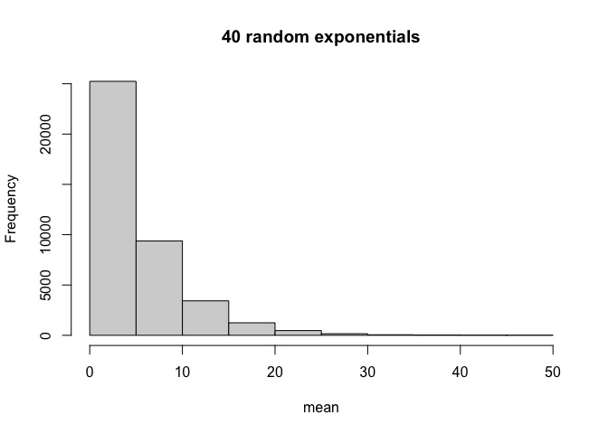
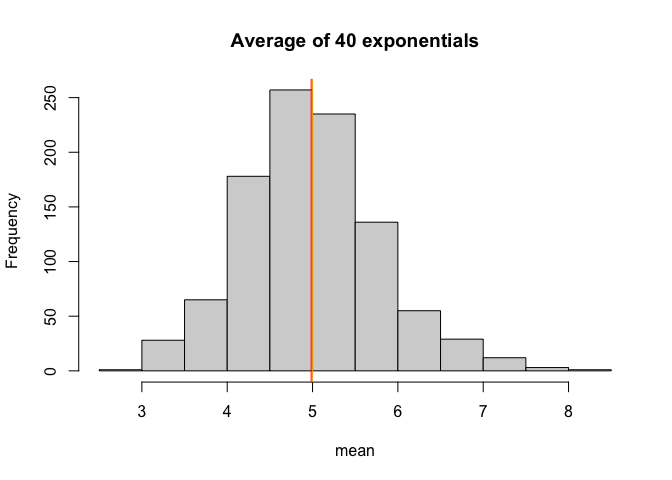
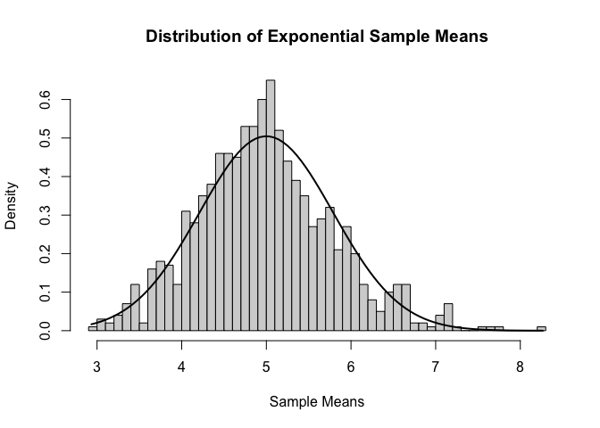
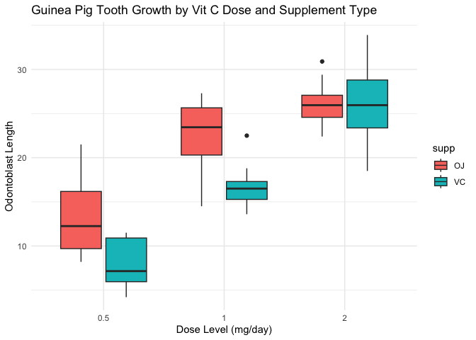

# Introduction / Synopsis

The project consists of two parts:

- A simulation exercise.
- Basic inferential data analysis.

# Initialisation

Set to show R code


``` r
library(datasets)
library(data.table)
library(ggplot2)
library(knitr)
library(dplyr)
library(tidyr)
opts_chunk$set(echo=TRUE)
```

# Assignment Part 1

## Instructions

In this project part, I will be investigating the exponential distribution in R and compare it with the Central Limit Theorem (CLT). I will be investigating the distribution of averages of 40 exponentials, and a total of a thousand simulations.

This project part requires the following :-

1. Show the sample mean and compare it to the theoretical mean of the distribution.
2. Show how variable the sample is (via variance) and compare it to the theoretical variance of the distribution.
3. Show that the distribution is approximately normal.

## Data Processing

### Sample exponential distribution


We first set our parameters

``` r
set.seed(44)
lambda <- 0.2
n <- 40
nosim <- 1000
```
We simulate the exponential distribution and take the sample means.

``` r
sample_simulated <- matrix(rexp(nosim*n, rate=lambda),nosim)
sample_means <- rowMeans(sample_simulated)
sample_mean <- mean(sample_means)
sample_sd <- sd(sample_means)
sample_variance <- sample_sd^2
```

### Theoretical exponential distribution

``` r
theoretical_mean <- 1/lambda
theoretical_sd <- (1/lambda)/sqrt(n)
theoretical_variance <- ((1/lambda)/sqrt(n))^2
```

### Visualization


``` r
hist(sample_simulated, xlab = "mean", main = "40 random exponentials")
```

<!-- -->


``` r
# visualization
hist(sample_means, xlab = "mean", main = "Average of 40 exponentials")
abline(v = sample_mean, col = "red")
abline(v = theoretical_mean, col = "orange")
```

<!-- -->

We can see that the averages themselves follow the form of a normal distribution. We will examine this later. The orange line indicates the theoretical mean of the distribution.

### Answers

Q. Show the sample mean and compare it to the theoretical mean of the distribution.

A. The sample mean is 4.9837334 and the theoretical mean is 5

Q. Show how variable the sample is (via variance) and compare it to the theoretical variance of the distribution.

A. The sample variance is 0.6356384 and the theoretical variance is 0.625. The sample SD is 0.7972693 and the theoretical sd is 0.7905694.

Q. Show that the distribution is approximately normal.

``` r
hist(sample_means, breaks=n, probability=TRUE, main = "Distribution of Exponential Sample Means", xlab = "Sample Means")

x_axis <- seq(min(sample_means),max(sample_means),length=100)
y_axis <- dnorm(x_axis, mean = theoretical_mean, sd = theoretical_sd)
lines(x_axis,y_axis,lwd=2)
```

<!-- -->

A. Due to the central limit theorem (CLT), the distribution of averages of 40 exponentials is very close to a normal distribution.


# Assignment Part 2

## Instructions

1. Load the ToothGrowth data and perform some basic exploratory data analyses
2. Provide a basic summary of the data.
3. Use confidence intervals and/or hypothesis tests to compare tooth growth by supp and dose. (Only use the techniques from class, even if there's other approaches worth considering)
4. State your conclusions and the assumptions needed for your conclusions.

## Data Processing

We will load the data and perform some exploratory analysis.


``` r
data("ToothGrowth")
head(ToothGrowth)
```

```
##    len supp dose
## 1  4.2   VC  0.5
## 2 11.5   VC  0.5
## 3  7.3   VC  0.5
## 4  5.8   VC  0.5
## 5  6.4   VC  0.5
## 6 10.0   VC  0.5
```

``` r
summary(ToothGrowth)
```

```
##       len        supp         dose      
##  Min.   : 4.20   OJ:30   Min.   :0.500  
##  1st Qu.:13.07   VC:30   1st Qu.:0.500  
##  Median :19.25           Median :1.000  
##  Mean   :18.81           Mean   :1.167  
##  3rd Qu.:25.27           3rd Qu.:2.000  
##  Max.   :33.90           Max.   :2.000
```

## Summary
The response is the length of odontoblasts (cells responsible for tooth growth) in 60 guinea pigs. Each animal received one of three dose levels of vitamin C (0.5, 1, and 2 mg/day) by one of two delivery methods, orange juice or ascorbic acid (a form of vitamin C and coded as VC).

Here, we assume that the underlying samples are independent, randomly assigned, and roughly normally distributed.

The dose seems to be in discrete values so we can convert it to a factor before we perform an exploratory plot.


``` r
ToothGrowth$dose <- as.factor(ToothGrowth$dose)
ggplot(ToothGrowth, aes(x = dose, y = len, fill = supp)) +
  geom_boxplot() +
  labs(title = "Guinea Pig Tooth Growth by Vit C Dose and Supplement Type",
       x = "Dose Level (mg/day)",
       y = "Odontoblast Length") +
  theme_minimal()
```

<!-- -->

The exploratory analysis suggests:

- A correlation between the dosage level and the tooth growth.
- The global absence of correlation between the delivery method and the tooth growth.
- A faster increase of the tooth length with the Orange Juince delivery method for the 0.5 and 1.0 dosage levels.

## Hypothesis Testing with confidence intervals

This section aims to compare tooth length with the following variables

- delivery method alone

- dosage levels alone

- delivery method and dosage levels combined

### Delivery Method

The null hypothesis is that there is no correlation between tooth length and the delivery method.

We first want to use confidence intervals and hypothesis tests to compare tooth growth by delivery method (OJ - orange juice or VC - asorbic acid)


``` r
ttest_deliver <- t.test(len ~ supp, data=ToothGrowth, var.equal=FALSE)

ttest_deliver$p.value
```

```
## [1] 0.06063451
```

``` r
ttest_deliver$conf.int
```

```
## [1] -0.1710156  7.5710156
## attr(,"conf.level")
## [1] 0.95
```
The p value is 0.0606345. As it is greater than 0.05 and the confidence interval contains zero, we fail to reject the null hypothesis.

### Dosage Levels

The null hypothesis is that there is no correlation between tooth length and the dosage levels.

We can also compare between different dosage levels. We slice the test framework across specific dosage subsets before re-performing the T test.


``` r
dose_0510 <- subset(ToothGrowth, dose %in% c(.5, 1.0))
ttest_dose0510 <- t.test(len ~ dose, data = dose_0510, var.equal = FALSE)

ttest_dose0510$p.value
```

```
## [1] 1.268301e-07
```

``` r
ttest_dose0510$conf.int
```

```
## [1] -11.983781  -6.276219
## attr(,"conf.level")
## [1] 0.95
```
The p value is 1.2683007\times 10^{-7}. As it is smaller than 0.05 and the 95% confidence interval does not contain zero, we can reject the null hypothesis.


``` r
dose_0520 <- subset(ToothGrowth, dose %in% c(.5, 2.0))
ttest_dose0520 <- t.test(len ~ dose, data = dose_0520, var.equal = FALSE)

ttest_dose0520$p.value
```

```
## [1] 4.397525e-14
```

``` r
ttest_dose0520$conf.int
```

```
## [1] -18.15617 -12.83383
## attr(,"conf.level")
## [1] 0.95
```
The p value is 4.397525\times 10^{-14}. As it is smaller than 0.05 and the 95% confidence interval does not contain zero, we can reject the null hypothesis.

The conclusion is that the t tests confirm a correlation between the dosage level and the tooth length.

### Both Delivery Methods and Dosage Levels

The null hypothesis is that there is no correlation between the delivery method and the tooth length for a given dosage level.

We first subset the data by dosage level and then apply the T test.


``` r
dose_05 <- subset(ToothGrowth, dose %in% c(.5))
ttest_dose05 <- t.test(len ~ supp, data = dose_05, var.equal = FALSE)

ttest_dose05$p.value
```

```
## [1] 0.006358607
```

``` r
ttest_dose05$conf.int
```

```
## [1] 1.719057 8.780943
## attr(,"conf.level")
## [1] 0.95
```
The p value is 0.0063586. As it is smaller than 0.05 and the 95% confidence interval does not contain zero, we can reject the null hypothesis.


``` r
dose_10 <- subset(ToothGrowth, dose %in% c(1.0))
ttest_dose10 <- t.test(len ~ supp, data = dose_10, var.equal = FALSE)

ttest_dose10$p.value
```

```
## [1] 0.001038376
```

``` r
ttest_dose10$conf.int
```

```
## [1] 2.802148 9.057852
## attr(,"conf.level")
## [1] 0.95
```
The p value is 0.0010384. As it is smaller than 0.05 and the 95% confidence interval does not contain zero, we can reject the null hypothesis.


``` r
dose_20 <- subset(ToothGrowth, dose %in% c(2.0))
ttest_dose20 <- t.test(len ~ supp, data = dose_20, var.equal = FALSE)

ttest_dose20$p.value
```

```
## [1] 0.9638516
```

``` r
ttest_dose20$conf.int
```

```
## [1] -3.79807  3.63807
## attr(,"conf.level")
## [1] 0.95
```
The p value is 0.9638516. As it is larger than 0.05 and the 95% confidence interval contains zero, we fail to reject the null hypothesis.

The t tests confirm a correlation between the delivery method and the tooth length for the 1.0 and 1.5 dosage levels but fail to confirm a correlation between the delivery method and the tooth length for the 2.0 dosage level.

## Conclusion

Based on the analysis, the following can be concluded 

- An increase in the dosage level results in an increase in tooth length

- The delivery method does not impact the tooth length when the dosage level is 2.0

- The orange juice delivery method impacts the tooth length at the 0.5 and 1.0 dosage levels more than the ascorbic acid at the same levels.


