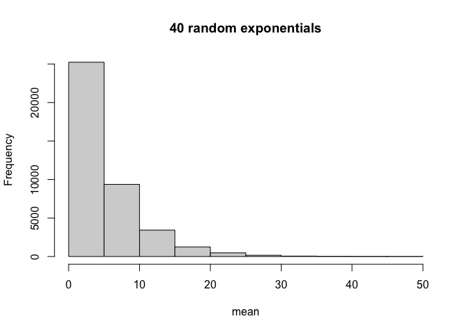
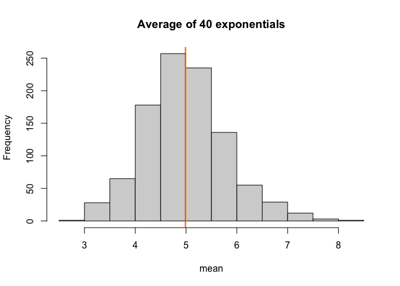
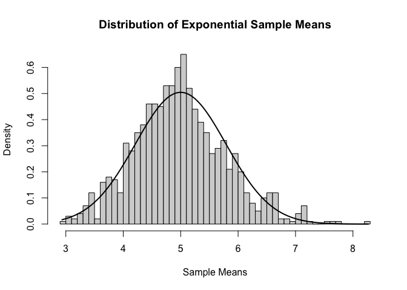

# Introduction / Synopsis

The project consists of one part(s):

- A simulation exercise.

# Initialisation

Set to show R code


``` r
library(datasets)
library(data.table)
library(ggplot2)
library(knitr)
library(dplyr)
library(tidyr)
opts_chunk$set(echo=TRUE)
```

# Assignment Part 1

## Instructions

In this project part, I will be investigating the exponential distribution in R and compare it with the Central Limit Theorem (CLT). I will be investigating the distribution of averages of 40 exponentials, and a total of a thousand simulations.

This project part requires the following :-

1. Show the sample mean and compare it to the theoretical mean of the distribution.
2. Show how variable the sample is (via variance) and compare it to the theoretical variance of the distribution.
3. Show that the distribution is approximately normal.

## Data Processing

### Sample exponential distribution


We first set our parameters

``` r
set.seed(44)
lambda <- 0.2
n <- 40
nosim <- 1000
```
We simulate the exponential distribution and take the sample means.

``` r
sample_simulated <- matrix(rexp(nosim*n, rate=lambda),nosim)
sample_means <- rowMeans(sample_simulated)
sample_mean <- mean(sample_means)
sample_sd <- sd(sample_means)
sample_variance <- sample_sd^2
```

### Theoretical exponential distribution

``` r
theoretical_mean <- 1/lambda
theoretical_sd <- (1/lambda)/sqrt(n)
theoretical_variance <- ((1/lambda)/sqrt(n))^2
```

### Visualization


``` r
hist(sample_simulated, xlab = "mean", main = "40 random exponentials")
```

<!-- -->


``` r
hist(sample_means, xlab = "mean", main = "Average of 40 exponentials")
abline(v = sample_mean, col = "red")
abline(v = theoretical_mean, col = "orange")
```

<!-- -->

We can see that the averages themselves follow the form of a normal distribution. We will examine this later. The orange line indicates the theoretical mean of the distribution.

### Answers

Q. Show the sample mean and compare it to the theoretical mean of the distribution.

A. The sample mean is 4.9837334 and the theoretical mean is 5

Q. Show how variable the sample is (via variance) and compare it to the theoretical variance of the distribution.

A. The sample variance is 0.6356384 and the theoretical variance is 0.625. The sample SD is 0.7972693 and the theoretical sd is 0.7905694.

Q. Show that the distribution is approximately normal.

``` r
hist(sample_means, breaks=n, probability=TRUE, main = "Distribution of Exponential Sample Means", xlab = "Sample Means")

x_axis <- seq(min(sample_means),max(sample_means),length=100)
y_axis <- dnorm(x_axis, mean = theoretical_mean, sd = theoretical_sd)
lines(x_axis,y_axis,lwd=2)
```

<!-- -->

A. Due to the central limit theorem (CLT), the distribution of averages of 40 exponentials tracks very close to a normal distribution.
